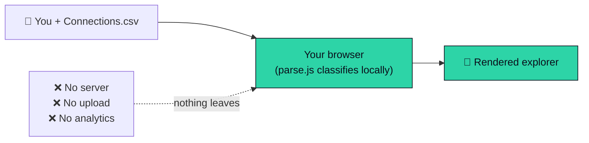
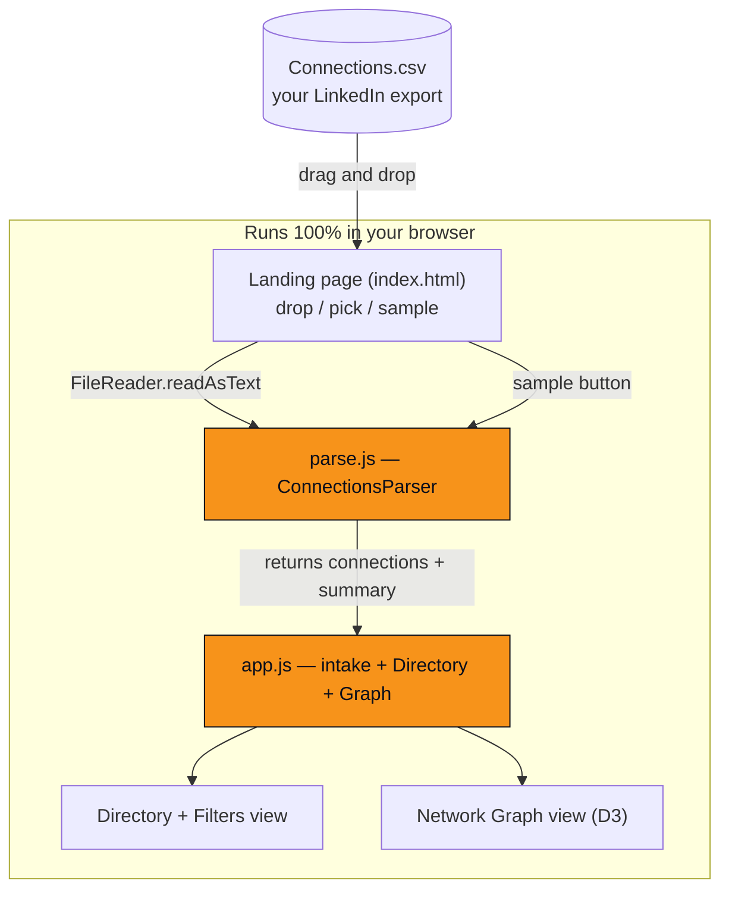
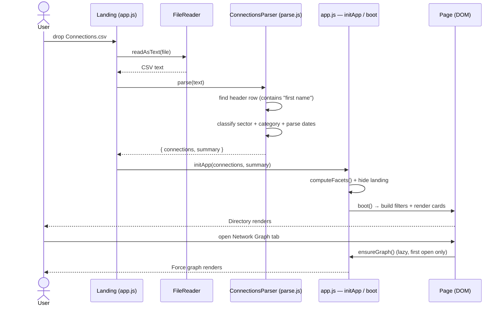
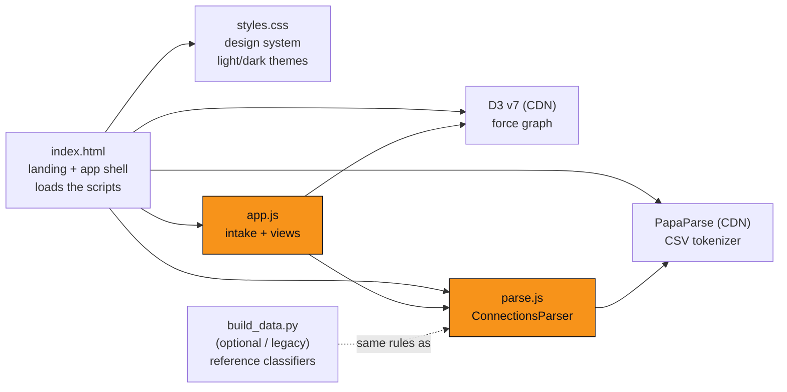
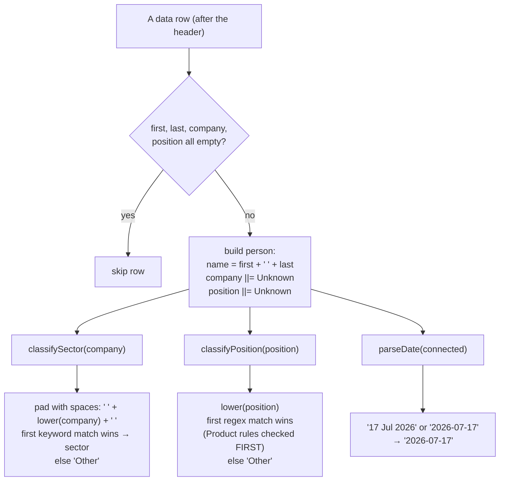
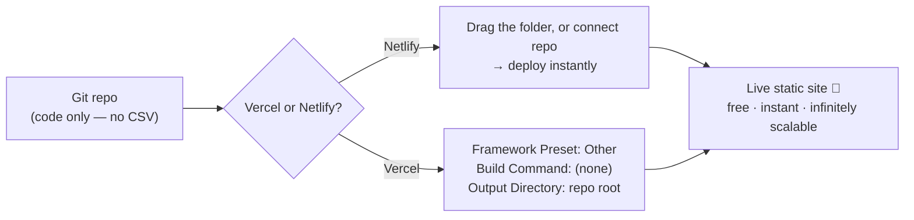

# 🔗 Connections Explorer

**Drop your LinkedIn `Connections.csv` and instantly explore your network — a filterable directory plus an interactive hub-and-spoke graph. 100% in your browser, nothing uploaded.**

Connections Explorer turns the raw `Connections.csv` you can export from LinkedIn into two live views:

1. **Directory & Filters** — search, multi-select sectors/roles, company & position dropdowns, sorting, and connection-year filters over a responsive card grid.
2. **Network Graph** — a D3 force-directed hub-and-spoke map that groups your connections by **company**, **exact position**, or **role family** (all PM variants roll into one *Product* hub).

It's a single static web page — no backend, no database, no account, no build step.

---

## Table of contents

- [Why this exists](#why-this-exists)
- [🔒 Privacy: how it actually works](#-privacy-how-it-actually-works)
- [How it works (architecture)](#how-it-works-architecture)
- [Tech stack](#tech-stack)
- [Project structure](#project-structure)
- [Quick start](#quick-start)
- [Getting your `Connections.csv` from LinkedIn](#getting-your-connectionscsv-from-linkedin)
- [Data model & classification](#data-model--classification)
- [The two views](#the-two-views)
- [Deploying (Vercel / Netlify)](#deploying-vercel--netlify)
- [Debugging & troubleshooting](#debugging--troubleshooting)
- [The optional Python build path (legacy)](#the-optional-python-build-path-legacy)
- [Development notes](#development-notes)

---

## Why this exists

LinkedIn gives you your connection list as a flat CSV. That's useful as a backup, useless as insight. This tool answers questions the CSV can't on its own:

- *How many of my connections are in crypto vs. banking vs. fintech?* → sector classification
- *Who are all the product people I know?* → role-family grouping (PM, APM, Lead, CPO → **Product**)
- *Which companies am I most connected to?* → company hubs sized by headcount
- *Who did I connect with this year?* → connection-year filter

And it does it without you ever handing your data to a third party.

---

## 🔒 Privacy: how it actually works

> **Your file is parsed entirely in your browser and is never uploaded anywhere. There is no server.**

This is the core design principle and it's verifiable, not just a promise:



**Prove it to yourself:** open your browser's DevTools → **Network** tab, then drop your CSV. The only requests you'll ever see are the initial CDN script loads (`papaparse`, `d3`). Your connection data **never appears in any network request**. You can even save the page and run it with the internet unplugged.

The repo itself ships **no personal data** — `Connections.csv`, generated `data.js`, and the `linkedin-data/` archive are all gitignored and excluded from deploy. (See [Debugging](#debugging--troubleshooting) → "Verifying privacy".)

---

## How it works (architecture)

Four static files + two CDN libraries, glued together by a single intake function.



### From drop to render (sequence)



Key points:

- **No global data bake.** The app no longer reads a pre-built `data.js`. `app.js` starts empty (`PEOPLE = []`) and is populated by `initApp(connections, summary)` when a file is dropped.
- **Lazy graph.** The D3 simulation only initializes the first time you open the Network Graph tab (`ensureGraph()`), so the directory is instant on load.
- **Drop anywhere.** The landing wires `dragenter`/`dragover`/`drop` on the whole window, so you can release the file anywhere on the page.

---

## Tech stack

| Piece | What | Why |
|---|---|---|
| **Vanilla JS** | `app.js`, `parse.js` | No framework, no bundler, no build step — just open the file. |
| **[PapaParse 5](https://www.papaparse.com/)** | CSV tokenizer (CDN) | Robust RFC-4180 parsing of LinkedIn's quoted/multi-line cells. |
| **[D3 v7](https://d3js.org/)** | Force-directed graph (CDN) | The hub-and-spoke layout, zoom/pan, drag, tooltips. |
| **CSS custom properties** | `styles.css` | One source of truth for the light/dark design system. |
| **Python 3** *(optional)* | `build_data.py` | Legacy/offline reference for the same classification rules. Not required to run the app. |
| **Fonts** | Inter + Space Grotesk (Google Fonts) | UI + display typography. |

**Browser support:** any modern evergreen browser (Chrome, Firefox, Safari, Edge). Uses ES5/ES6, `FileReader`, and `localStorage`. No Internet Explorer.

---

## Project structure



| File | Role | Shipped? |
|---|---|---|
| `index.html` | Landing page (drop zone, file picker, sample button, privacy copy) + the two-view app shell. Loads the scripts. | ✅ |
| `styles.css` | Design tokens, glassy panels, light/dark themes, responsive layout. | ✅ |
| `app.js` | Intake handlers, Directory & Filters view, Network Graph view, theme toggle. Exposes `initApp()`. | ✅ |
| `parse.js` | `ConnectionsParser.parse(text)` + `SAMPLE_CSV`. Mirrors `build_data.py` exactly. | ✅ |
| `build_data.py` | Optional Python that regenerates a `data.js` (the old offline build path). Kept as the reference spec for the classifiers. | ✅ |
| `Connections.csv` | **Your** LinkedIn export. | ❌ gitignored |
| `data.js` | Generated by `build_data.py` (legacy). | ❌ gitignored |
| `linkedin-data/` | Full LinkedIn data archive. | ❌ gitignored |

---

## Quick start

No install. No build. Two options:

**Option A — just open it.** Double-click `index.html`, or:

```bash
# from the project folder
open index.html        # macOS
# xdg-open index.html  # Linux
```

**Option B — serve it (recommended; avoids any `file://` quirks and lets you verify privacy in the Network tab):**

```bash
# Python 3 (already installed on most systems)
python3 -m http.server 8000
# then visit http://localhost:8000

# …or with Node
npx serve .
```

Then:

1. Open the page → you'll see the **landing** with a drop zone.
2. **Drop your `Connections.csv`** (or click *browse for a file*, or click *Try it with sample data*).
3. Explore. Toggle between **Directory & Filters** and **Network Graph** with the top tabs.

---

## Getting your `Connections.csv` from LinkedIn

1. Go to **LinkedIn → Settings & Privacy → Data Privacy**.
2. Click **Get a copy of your data**.
3. Select **Connections** (you can pick just this — it's fast).
4. Request the archive. LinkedIn emails you a download link (usually within minutes).
5. Unzip it. Inside is **`Connections.csv`** — drop that into the app.

The file's first few rows are LinkedIn preamble (a "Notes:" row, a long quoted privacy blurb, a blank line, then the header `First Name,Last Name,URL,Email Address,Company,Position,Connected On`). The parser **detects the header dynamically** by scanning for a row containing `First Name`, so it tolerates variations in that preamble and even reordered columns.

---

## Data model & classification

`ConnectionsParser.parse(text)` returns `{ connections, summary }`.

**One connection:**

```js
{
  id, firstName, lastName, name,   // identity
  url, email,                       // contact (from the CSV)
  company, position,                // raw fields ("Unknown" if blank)
  sector,                           // derived from company
  category,                         // derived from position
  connected                         // "YYYY-MM-DD"
}
```

**Summary:** `{ total, sectors: {name: count}, categories: {name: count}, companyCount, positionCount }` — `sectors` and `categories` are ordered by frequency.

### How a row is classified



### Sectors (derived from company name, first-match-wins)

| Sector | Color | Example keywords |
|---|---|---|
| Freelance / Stealth | `#94a3b8` | stealth, freelance, self-employed |
| Crypto & Web3 | `#f7931a` | crypto, blockchain, binance, bybit, web3 |
| Banking & Broking | `#4f8bff` | bank, zerodha, hdfc, securities, nse |
| Fintech & Payments | `#2dd4a7` | pay, razorpay, phonepe, upi, stripe |
| AI & Data | `#a78bfa` | ai, data, analytics, llm |
| Education & Learning | `#facc15` | education, academy, edtech, school |
| Media & Marketing | `#f472b6` | media, marketing, agency, studio |
| Consulting & Advisory | `#2dd4bf` | consult, mckinsey, bain, deloitte |
| E-commerce & Retail | `#fb7185` | commerce, retail, flipkart, amazon |
| Healthcare & Pharma | `#fb5e7d` | health, med, pharma, clinic |
| HR & Talent | `#a3e635` | talent, recruit, staffing |
| Gaming & Entertainment | `#c084fc` | game, esports, play |
| Finance & Investment | `#fbbf24` | finance, capital, ventures, sequoia |
| Technology / SaaS | `#22d3ee` | software, saas, tech, labs |
| Other | `#8893ad` | (no keyword matched) |

### Role categories (derived from position, first-match-wins, **Product first**)

`Product` → `Founder & Executive` → `Leadership & Management` → `Engineering & Tech` → `Data & AI` → `Design & UX` → `Marketing & Growth` → `Sales & BD` → `Finance` → `Operations` → `HR & People` → `Trading & Research` → `Other`.

> **Why Product first?** Without it, generic "manager/lead/director" rules would steal PMs into *Leadership*. Checking Product first (`product`, `pm`, `apm`, `tpm`, `gpm`) ensures PM/APM/Product Lead/CPO all roll into one **Product** bucket — which is what makes the *Role* graph mode useful.

Both rule tables live in **`parse.js`** (browser) and **`build_data.py`** (reference). They are identical and must be kept in sync; the JS output was verified byte-for-byte against the Python on a real 1,000+ row file.

---

## The two views

### 1. Directory & Filters
A left-hand filter panel + a responsive card grid. Filters compose: **search** (name/company/position), multi-select **sector** and **role-category** chips (with live counts, frequency-ordered), **Company** / **Position** A–Z dropdowns, **sort** (recent / name / company / position), and **connected-since year**. Cards show an initials avatar, name → LinkedIn link, position, company + sector dot, a filled sector tag and outlined role tag, and the connection date. (Grid is capped at 400 cards with a "+N more — narrow your filters" footer to stay snappy on big networks.)

### 2. Network Graph (hub-and-spoke)
A full-bleed D3 force layout. **Group by** three modes:

| Mode | Hub = | Good for |
|---|---|---|
| **Company** | each company | "which firms am I most connected to" |
| **Position** | each exact job title | title-level clusters |
| **Role** | each role family | all PM variants merge into one **Product** hub |

Hubs are sized by headcount (`r = 10 + √count·4.2`), colored by their members' dominant sector, and labeled with a count. Each person is a small dot linked to their hub. **Drag** nodes, **scroll** to zoom, **pan**, **hover** for a tooltip, **click a hub** to isolate it (detail panel lists members with LinkedIn links), **click a person** to open their LinkedIn.

Controls: role/sector filter dropdowns, a **min-connections-per-hub slider** (1–10, default 3 — raise it to declutter), and a **focus-a-hub** search. *Re-layout* and *Fit to screen* buttons, a color legend, and live stats.

**Deep-linking:** share a specific view — `?view=graph&mode=category&category=Product&min=1` — or use the URL hash `#directory` / `#graph`.

**Performance guard:** when a graph exceeds 1000 nodes the simulation switches to faster settle parameters (`alphaDecay 0.06`, `velocityDecay 0.35`) and shows a "Large graph — settling" note. Nothing is truncated.

---

## Deploying (Vercel / Netlify)

Because it's a static site, deployment is trivial and free.



**Netlify:**
- Easiest: drag the project folder onto [app.netlify.com/drop](https://app.netlify.com/drop), **or**
- Connect the Git repo → deploy. No config needed.

**Vercel:**
- `npm i -g vercel && vercel` in the folder, **or** connect the repo.
- When prompted: **Framework Preset → Other**, **Build Command → (leave empty)**, **Output Directory → `.` (repo root)**.

> Since the repo contains no personal data (CSVs are gitignored), the deployed site ships only code — so the "nothing leaves your device" promise holds for every visitor, who drops *their own* file.

---

## Debugging & troubleshooting

Open the browser **DevTools** (`F12` / `Cmd+Opt+I`):

| Symptom | Likely cause / fix |
|---|---|
| **Nothing happens when I drop** | Check the **Console** for errors and the **Network** tab — the CDN scripts (`papaparse`, `d3`) must load. Fully offline + CDN blocked? Self-host those two files and point the `<script src>` at them. |
| **"no valid header row found"** | The file isn't a LinkedIn Connections export, or its header doesn't contain `First Name`. Re-export from LinkedIn (see above). |
| **Graph is empty / has no hubs** | In **Company** mode with the default **min = 3**, companies you're connected to only once won't form hubs. Switch to **Role** mode, or lower the min-connections slider to 1. |
| **Graph is slow/jittery** | Expected on very large networks — the perf guard kicks in past 1000 nodes ("Large graph — settling"). Give it a moment, raise the min slider, or filter by sector/role. |
| **A connection is in the wrong sector/role** | Classification is a keyword/regex heuristic, not perfect. Inspect with the console (below), then tune the rule tables in **`parse.js`** (and mirror in `build_data.py`). |
| **Theme flashes on load** | The pre-paint `<head>` script reads `localStorage['ce-theme']` before paint to avoid this. If JS is disabled, it falls back to your OS preference. |
| **"PapaParse is not loaded"** | The Papa CDN script failed (offline/firewall). Self-host `papaparse.min.js`. |

**Handy console checks** (while serving locally):

```js
// Does your file parse, and how did it classify? (summary only — no personal dump)
fetch('Connections.csv').then(r => r.text()).then(t => console.log(ConnectionsParser.parse(t).summary))

// Inspect one classified row
ConnectionsParser.parse(await (await fetch('Connections.csv')).text()).connections[0]

// Drive the app manually from the console
ConnectionsApp.initApp(parsed.connections, parsed.summary)
```

**Verifying privacy:** with the **Network** tab open and "Preserve log" on, drop your CSV. You will see **no** request carrying your data — only the initial script loads. That's the proof that nothing is uploaded.

**Regenerating the legacy `data.js`** (optional — only if you want the old offline build path):

```bash
python3 build_data.py     # writes data.js from Connections.csv (gitignored)
```

---

## The optional Python build path (legacy)

Before this was a drop-to-load app, `build_data.py` read `Connections.csv` and wrote a `data.js` that `index.html` loaded at startup. That script is **kept as the reference spec** for the classification rules and still works:

```bash
python3 build_data.py    # → data.js (gitignored, not used by the live app anymore)
```

The browser port in `parse.js` reproduces it exactly (the only intentional difference: `parse.js` **detects** the header row dynamically instead of hard-coding "skip 4 rows", so it's more robust to export variations). If you change a rule, change it in **both** files.

---

## Development notes

- **Adding a second data source:** route anything through `initApp(connections, summary)` in `app.js`. It sets `PEOPLE`/`SUMMARY`, calls `computeFacets()` (which rebuilds the `SECTORS`/`CATEGORIES` lists), hides the landing, and boots. Don't re-add a top-level `window.CONNECTIONS` read.
- **User input is escaped** everywhere via the `esc()` helper before being injected into HTML — safe against malformed CSV cells.
- **Stable D3 keys:** hubs use `hub:<name>`, people use `p:<id>`, so re-layouts update in place rather than rebuilding.
- **Theme re-skin without re-sim:** toggling the theme calls `refreshGraphColors()`, which re-reads CSS variables and recolors the graph without restarting the force simulation.
- **Colors in two places:** the sector palette is defined in both `styles.css` (`--crypto`, `--banking`, …) and `app.js` (`SECTOR_COLORS`). Keep them in sync if you rebrand.

---

*Built as a private, offline-friendly way to make sense of a LinkedIn export. Your network stays yours.*
